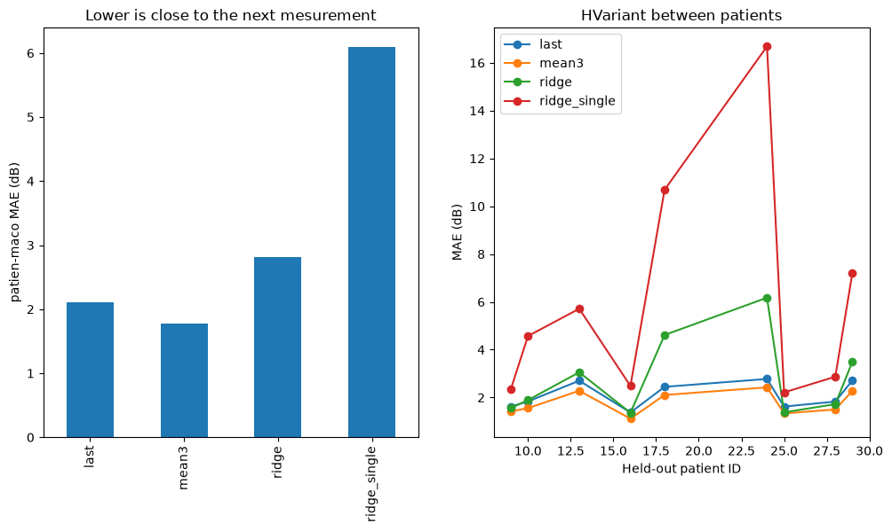
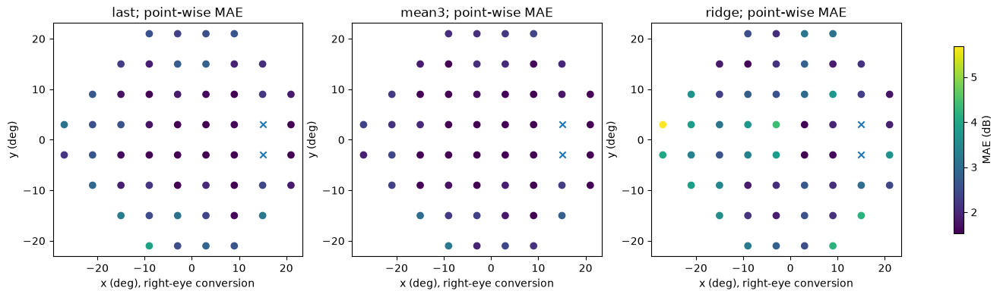
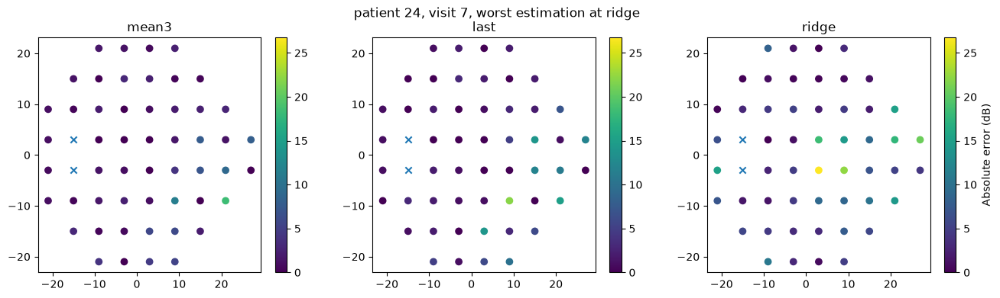
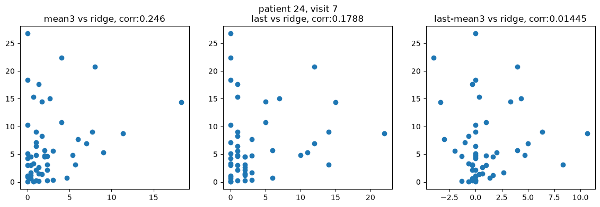

# 網膜感度データ解析チュートリアル

## 概要
ChatGPTに網膜データを用いた解析のチュートリアルを作成してもらい、できるだけコードを見ずに、説明・図・実行結果を中心に解析を進めた記録です。

使用するのは視野検査で測定された網膜感度の数値データです。過去3回分の測定から次の1回の測定値を推定するモデルを作成します。

## 使用データ
[公開データ一覧](https://imarinfr.r-universe.dev/datasets)の `visualFields::vfpwgRetest24d2` を使用。30患者・360検査。52測定点を解析。

## 方法

患者単位に21人の学習用と9人の評価用に分割。直近値、過去3回平均、Ridge回帰を比較。

各データは、3回分の検査データを入力、その次の検査データを出力とする。また、入力データは直近値と過去3回平均から直近値を引いた差分を使用。

チュートリアルとしては過去の平均とその平均から直前にどれだけ変化したのかが予測に関わるのではと仮定している。

## 結果

結果としてはリッジ回帰の性能は低く、過去三回平均の値をそのまま用いる方が予測性能としては高い。

測定点平均でのMAEの結果を見ても、少なくとも目視の範囲ではridgeの予測性能が悪い。

paired boootstrapという手法。基本的には2群間での比較を行う。多重比較なのでBonferroni補正を適用。やはりリッジ回帰のほうが性能が不十分だった。

|      |    compared | mean_difference_dB | low 0.008333 | high 0.9917 | num_patients |
| ---: | ----------: | -----------------: | -----------: | ----------: | -----------: |
|    0 |  last-mean3 |           0.322333 |     0.268381 |    0.377891 |            9 |
|    1 |  last-ridge |          -0.703639 |    -1.761403 |    0.033613 |            9 |
|    2 | mean3-ridge |          -1.025973 |    -2.124628 |   -0.255731 |            9 |

2郡間のt検定ではlast-mean3間とmean3-ridge間には有意差(t<0.05)はついたが、last-ridge間は有意差はつかなかった。

|      |    compared | 平均MAE差 |      p値 |   95% low | 95% high  |
| ---: | ----------: | --------: | -------: | --------: | --------- |
|    0 |  last-mean3 |  0.322333 | 0.000001 |  0.265468 | 0.379198  |
|    1 |  last-ridge | -0.703639 | 0.131214 | -1.668732 | 0.261453  |
|    2 | mean3-ridge | -1.025973 | 0.043402 | -2.013134 | -0.038811 |

低感度域ほど推定が難しいという先行研究があるらしい。
データを3層化すると、低感度域は確かにMAEが大きくなる。

| band |   method | patients_with_points | point_observations | patient_macro_MAE_dB |           |
| ---: | -------: | -------------------: | -----------------: | -------------------: | --------- |
|    0 |  0-15 dB |                 last |                  5 |                  212 | 5.421919  |
|    1 |  0-15 dB |                mean3 |                  5 |                  212 | 4.470096  |
|    2 |  0-15 dB |                ridge |                  5 |                  212 | 9.232172  |
|    3 |  0-15 dB |         ridge_single |                  5 |                  212 | 13.985561 |
|    4 | 15-25 dB |                 last |                  9 |                  763 | 3.520368  |
|    5 | 15-25 dB |                mean3 |                  9 |                  763 | 3.031421  |
|    6 | 15-25 dB |                ridge |                  9 |                  763 | 3.672830  |
|    7 | 15-25 dB |         ridge_single |                  9 |                  763 | 7.809266  |
|    8 |   25+ dB |                 last |                  9 |                 3237 | 1.573093  |
|    9 |   25+ dB |                mean3 |                  9 |                 3237 | 1.319707  |
|   10 |   25+ dB |                ridge |                  9 |                 3237 | 2.134711  |
|   11 |   25+ dB |         ridge_single |                  9 |                 3237 | 5.248115  |

患者別の

|      |     last |    mean3 |    ridge | ridge_single |
| ---: | -------: | -------: | -------: | -----------: |
|   id |          |          |          |              |
|    9 | 1.621795 | 1.418803 | 1.560612 |     2.364652 |
|   10 | 1.837607 |  1.55698 | 1.894212 |     4.572938 |
|   13 | 2.702991 | 2.282051 |  3.05491 |     5.713969 |
|   16 | 1.376068 | 1.116097 | 1.361135 |     2.484645 |
|   18 | 2.446581 |  2.10755 | 4.615676 |    10.688969 |
|   24 | 2.777778 | 2.425926 | 6.175672 |    16.688715 |
|   25 | 1.621795 | 1.336182 | 1.379022 |     2.215688 |
|   28 | 1.831197 | 1.501425 | 1.723277 |     2.869785 |
|   29 | 2.711538 | 2.281339 |  3.49559 |     7.209955 |

最もridge回帰の誤差が大きい患者データを可視化。

同患者について直近値、過去3回平均と、ridge回帰の値の相関を見た。概ね相関なし。

## 考察と限界

今回はチュートリアルとして、網膜の感度データを読み込み、可視化と解析を行った。

今回はチュートリアルとは異なるデータ分割を行ったため、チュートリアルと値は異なるが、過去3回平均、直近値、Ridge回帰の順で成績が良かった。今回は訪問時期を学習データに加えていないが、進行速度と検査頻度の関係性が影響する恐れは考えられる。例えば、進行が速い患者であったとしても、頻繁に検査を繰り返していれば3回分の値の変動は小さくなりうる。そのため、直近3回を用いる推測の場合、時系列データを加えた形で推定モデルの作成を検討しても良いかもしれない。ridge回帰の性能は出なかった。また、ridge回帰の推定値が負の値を含んだため、正の値に制限されるような推測方法を採用すれば改善する可能性は期待される。

Ridge回帰のalphaが非常に大きい(α=159.99)が、これは入力データ点が104件だから。手動で設定したridge_single(α=1)よりは成績は良い。

念の為、データ全体を横方向に結合したデータで回帰した結果(`_all`付き)、線型回帰(`linear`)を追加し、全体での負の数、MAEを求めた。データ全体を用いたほうがわずかに元のリッジ回帰の結果よりMAEは良好だが、負の値の推測点自体は増えてしまった。線型回帰については負の値の推測点が非常に多い結果となった。

|           | last | mean3 | ridge | ridge_single | rideg_all | linear | linear_all |
| --------: | ---: | ----: | ----: | -----------: | --------: | -----: | ---------: |
|  negative | 0.00 |  0.00 |  1.00 |        63.00 |      5.00 |  71.00 |     177.00 |
| MAE (all) | 2.10 |  1.78 |  2.81 |         6.09 |      2.78 |   6.31 |       8.73 |

